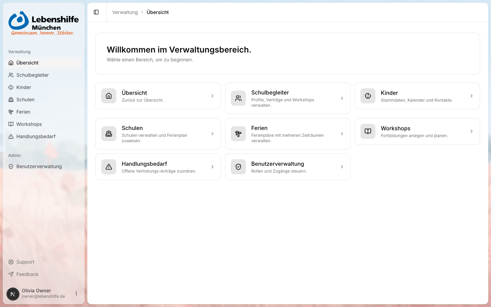
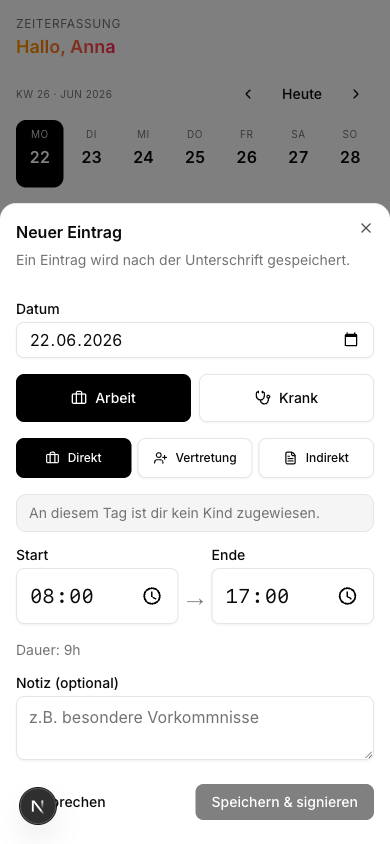

# Lebenshilfe

Time tracking and administration for school support (_Schulbegleitung_) at
Lebenshilfe München.

School assistants (_Schulbegleiter_) record the hours they spend with the children they
support and sign every entry. Administrators manage children, schools, assignments and
substitutes, and export signed hours for billing to the cost bearers (_Kostenträger_).

## Features

<table>
  <tr>
    <td width="70%"></td>
    <td width="30%"></td>
  </tr>
  <tr>
    <td align="center">Admin area</td>
    <td align="center">Schulbegleiter: new entry</td>
  </tr>
</table>

**For Schulbegleiter** (`/`, mobile-first)

- Record entries: work (_Arbeit_), indirect work (_Indirekt_), sick days (_Krank_) and
  substitute days (_Vertretung_). Each entry is signed on screen.
- Day, week and month views of their own entries and timetable.
- Report a child as sick.
- Close a month (_Monatsabschluss_) with the supervisor's signature. Closed months are
  locked.

**For admins and owners** (`/admin`)

| Area                   | What it covers                                                             |
| ---------------------- | -------------------------------------------------------------------------- |
| Schulbegleiter         | Profiles, invitations, weekly hours, pools, workshop attendance            |
| Kinder                 | Master data, school, Kostenträger, assignments, timetable, history         |
| Schulen / Ferienpläne  | Schools with address lookup, holiday plans shared between schools          |
| Pools / Workshops      | Pools of children and assistants per school, training workshops            |
| Handlungsbedarf        | To-do list: open substitute and indirect-work requests to assign           |
| Karte                  | Map of all assignments on a given day (Google Maps, with consent)          |
| Benutzerverwaltung     | Users, roles, invitations, two-factor reset                                |

End-user documentation (German) lives in [`docs/`](docs/) as a Mintlify site. Preview it
with `npm run docs:dev`.

## Local setup

### Prerequisites

- [Node.js](https://nodejs.org/) 22 or newer (CI uses 22, the Docker image uses 26)
- [Docker](https://www.docker.com/) for the database, mail and file-storage containers

### 1. Install dependencies

```bash
npm install
```

This also generates the Prisma client into `src/generated/prisma`. Run
`npx prisma generate` again whenever `prisma/schema.prisma` changes.

### 2. Configure environment variables

```bash
cp .env.example .env
```

Generate a secret and paste it into `BETTER_AUTH_SECRET` in `.env`:

```bash
openssl rand -base64 32
```

The other defaults match `docker-compose.yml` and work as they are. The Google Maps key
is optional; without it, school address lookup and the map stay empty.

### 3. Create and seed the database

```bash
npm run db:seed
```

This starts the containers, rebuilds the database from the migrations in
`prisma/migrations` (`prisma migrate reset`) and fills it with test data
(`scripts/seed.ts`). It **deletes all local data**, so run it again whenever you want a
fresh start.

> [!WARNING]
> **Known issue: MinIO images are no longer available.** MinIO removed the
> `minio/minio` and `minio/mc` images from Docker Hub, so `docker compose up` and
> `npm run db:seed` currently fail. Until `docker-compose.yml` is updated, start only the
> database and mail server and run the two seed steps yourself:
>
> ```bash
> docker compose up -d --wait db mailpit
> npx dotenv -e .env -- prisma migrate reset --force --skip-seed
> BETTER_AUTH_URL=http://localhost:3000 npx dotenv -e .env -- npx tsx scripts/seed.ts
> ```
>
> The app runs, but signing entries fails because signatures are stored in S3 (MinIO).

### 4. Start the dev server

```bash
npm run dev
```

Open [http://localhost:3000](http://localhost:3000).

### Test accounts

All seeded accounts use the password `Lebenshilfe-Dev-2026!`.

| Email                          | Role                           |
| ------------------------------ | ------------------------------ |
| `owner@lebenshilfe.de`         | Owner                          |
| `admin@lebenshilfe.de`         | Admin                          |
| `anna.schmidt@lebenshilfe.de`  | Schulbegleiter (also `ben.weber@…`, `clara.becker@…`) |

**Roles:** `SCHOOL_ASSISTANT` (Schulbegleiter), `ADMIN`, and `OWNER` (everything an admin
can do, plus managing owners). Users join only through an invitation.

Admins and owners must set up two-factor authentication on their first login. Use any
authenticator app (TOTP); there is no bypass in development. Re-seeding resets it, so
remove the old entry from your authenticator app afterwards.

### Local services

| Service      | URL / port                                       | Purpose                                         |
| ------------ | ------------------------------------------------ | ----------------------------------------------- |
| App          | [localhost:3000](http://localhost:3000)          | Next.js dev server                              |
| MySQL 8      | `localhost:3306` (user `root`, pw `lebenshilfe`) | Database `lebenshilfe_dev`                      |
| Mailpit      | [localhost:8025](http://localhost:8025)          | Catches all outgoing mail (invitations, resets) |
| MinIO        | [localhost:9001](http://localhost:9001)          | S3-compatible storage for signatures            |

## Tech stack

| Layer          | Technology                                                                                      |
| -------------- | ----------------------------------------------------------------------------------------------- |
| Framework      | [Next.js](https://nextjs.org/) 16 (App Router, Server Actions), React 19 with the React Compiler |
| Language       | TypeScript                                                                                      |
| Database       | MySQL 8 (Docker Compose locally)                                                                |
| ORM            | [Prisma](https://www.prisma.io/) 6 with migrations in `prisma/migrations`                       |
| Authentication | [Better Auth](https://www.better-auth.com/): invitation-based sign-up, TOTP two-factor           |
| Validation     | [Zod](https://zod.dev/)                                                                         |
| Styling / UI   | [Tailwind CSS](https://tailwindcss.com/) 4, [shadcn/ui](https://ui.shadcn.com/) on Radix         |
| File storage   | S3-compatible object storage (MinIO locally) for signatures                                     |
| Email          | React Email templates, sent via Mailpit (local) or [Resend](https://resend.com/)                |
| Tooling        | ESLint with `eslint-plugin-boundaries`, Prettier, Husky + lint-staged                           |

